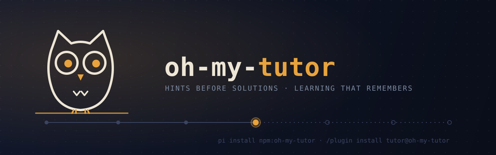

# oh-my-tutor

<picture>
  <source media="(prefers-color-scheme: dark)" srcset="assets/banner-dark.svg">
  <source media="(prefers-color-scheme: light)" srcset="assets/banner-light.svg">
  
</picture>

```bash
pi install npm:oh-my-tutor
```

Personal coding tutor for pi.

`oh-my-tutor` turns pi, Claude Code or Codex into a teaching-oriented coding assistant. All three share one learner profile and the same project tracks.

`oh-my-tutor` was called `pi-tutor` before. Profiles and tracks from that time keep working where they are. See [State layout](#state-layout).

It adapts to how you like to learn, remembers what you're learning, resumes topics over time, and guides you with hint-first help instead of jumping straight to solutions.

## What this is

`oh-my-tutor` is a tutor package for pi and a plugin for Claude Code. It is meant for learning while coding — not just getting answers, but building understanding, practicing in small steps, and keeping momentum across sessions.

## What it does

- adapts to your learning style and preferences
- remembers what you're learning and resumes it later
- keeps separate topic folders for different learning tracks
- prefers hints, questions, and next steps before full solutions
- helps you reflect on progress, blockers, and what to do next
- supports learning through small projects, exercises, and repeated practice

## Install

### From npm

```bash
pi install npm:oh-my-tutor
```

### From GitHub

```bash
pi install https://github.com/denismrvoljak/oh-my-tutor
```

### Local path install

Use this when developing on the package itself:

```bash
pi install /absolute/path/to/oh-my-tutor
pi list
```

### Project-local install

Use this when you want a clean temporary environment or project-scoped setup:

```bash
pi install -l /absolute/path/to/oh-my-tutor
pi list --approve
```

Pi 1.x ignores project-local packages until you trust the project. `--approve` trusts it for one run.

### One-off test

```bash
pi -e npm:oh-my-tutor
```

Then open pi and enable tutor mode:

```text
/tutor on
```

### Claude Code

This repository is also a Claude Code plugin and marketplace:

```text
/plugin marketplace add denismrvoljak/oh-my-tutor
/plugin install tutor@oh-my-tutor
```

For local development, run `claude --plugin-dir /absolute/path/to/oh-my-tutor`.

In Claude Code, the commands carry the plugin prefix: `/tutor:tutor on`, `/tutor:hint`, `/tutor:tutor-implementation`, and so on. A `UserPromptSubmit` hook (`claude/user-prompt-submit.mjs`) replaces the Pi extension. Tutor mode applies per session. The plugin uses the same learner profile and project tracks as Pi. The hook needs Node 22.18 or later.

While tutor mode is on, Pi shows `○ 🦉 tutor: ON` in its footer. The dot lights up while the agent is working. Claude Code can show `🦉 tutor: ON` in its status line, but a plugin cannot set the status line for you. To turn it on:

1. Run `/tutor:tutor on` once. This writes the launcher `~/.oh-my-tutor/statusline.mjs`.
2. Add this to `~/.claude/settings.json`:

   ```json
   "statusLine": { "type": "command", "command": "node ~/.oh-my-tutor/statusline.mjs" }
   ```

The status line prints nothing while tutor mode is off. If you already have a status line, this setting replaces it. To keep yours, call the launcher from your own status line script and print both outputs.

### Codex (experimental)

Codex installs the same plugin from the same marketplace:

```bash
codex plugin marketplace add denismrvoljak/oh-my-tutor
codex plugin add tutor@oh-my-tutor
```

Then open `codex`, run `/hooks` and approve the oh-my-tutor hook. Codex skips plugin hooks until you approve them, and asks again after every plugin update.

Codex has no plugin slash commands, so type `@tutor on`, `@tutor off` or `@tutor status`. Use `$hint`, `$reflect`, `$next_step` and `$start_tutoring` for the workflows. Codex has no tutor status item.

## What it includes

- `/tutor on`
- `/tutor off`
- `/tutor status`
- conversational onboarding that creates `learner-profile.md`
- topic tracks under `tracks/<topic-folder>/`
- track-aware prompt templates:
  - `/start_tutoring`
  - `/hint`
  - `/reflect`
  - `/next_step`
- track-aware skills for implementation mentoring and topic learning
- guards that require tutor mode to be on before tutor workflows run

## State layout

Tutor data is split across two roots: one global (learner identity), one per-project (learning tracks). Pi, Claude Code and Codex use the same roots.

### Global learner state

One home folder holds the learner profile for every harness and every project:

```text
~/.oh-my-tutor/
├── learner-profile.md   # learner preferences, goals, topics, and tutoring style
├── sessions/            # Claude Code and Codex: which sessions have tutor mode on
└── statusline.mjs       # Claude Code status line launcher
```

Set `OH_MY_TUTOR_DIR` to move the learner profile somewhere else. `PI_TUTOR_DIR`, the old name, still works.

If you used `pi-tutor` before, your profile is at `${PI_CODING_AGENT_DIR:-~/.pi/agent}/pi-tutor/learner-profile.md`. oh-my-tutor keeps using that file while it exists. To move it to the new home:

```bash
mkdir -p ~/.oh-my-tutor && mv ~/.pi/agent/pi-tutor/learner-profile.md ~/.oh-my-tutor/
```

### Per-project track state

Each learning stream gets its own directory under `.oh-my-tutor/tracks/<topic-folder>/`, inside the project repo the track is about — resolved as the nearest ancestor directory containing `.git`, falling back to the current working directory if none is found. A project that already has a `.pi-tutor/tracks/` folder from before the rename keeps using it.

```text
<project-root>/.oh-my-tutor/
└── tracks/
    └── <topic-folder>/
        ├── track.md
        ├── project.md
        ├── roadmap.md
        └── progress.md
```

The folder name is just a short filesystem-safe topic name.

File roles:

- `track.md` — what the track is about, keywords, learner-specific notes
- `project.md` — concrete project brief (goal, scope, acceptance criteria, constraints, deliverables)
- `roadmap.md` — milestones and checkbox todo tasks/exercises (`- [ ]` / `- [x]`)
- `progress.md` — journey status (roadmap completion), current focus, completed work, reflections, blockers, next step

This package is intentionally markdown-first. There is **no hidden active-track state** to keep in sync.

Tracks live in-repo so they're git-diffable and travel with the project (clone, branch, PR review). If you'd rather not commit tutoring state, add `.oh-my-tutor/` to the project's own `.gitignore` — oh-my-tutor does not do this for you.

### Migrating tracks created before this layout

Older versions of pi-tutor stored tracks globally, under `${PI_CODING_AGENT_DIR:-~/.pi/agent}/pi-tutor/tracks/<topic-folder>/`. That location still exists on disk if you had tracks from before, but oh-my-tutor no longer reads or writes it. To keep an existing track, copy its folder into the project it belongs to:

```bash
cp -r "${PI_CODING_AGENT_DIR:-~/.pi/agent}/pi-tutor/tracks/<topic-folder>" "/path/to/project/.oh-my-tutor/tracks/<topic-folder>"
```

## Local development install

Run `pnpm install` once in the package repo before installing it into pi.

```bash
cd /absolute/path/to/oh-my-tutor
pnpm install
```

For a clean project-local dev check:

```bash
cd /absolute/path/to/oh-my-tutor
pnpm install

export PI_CODING_AGENT_DIR="$(mktemp -d)"
tmp_proj="$(mktemp -d)"
cd "$tmp_proj"

pi install -l /absolute/path/to/oh-my-tutor
pi list
pi
```

## Local development workflow with `/reload`

After the first local install, keep editing files in `/absolute/path/to/oh-my-tutor` and use `/reload` inside pi instead of reinstalling every time.

Typical loop:

```bash
cd /absolute/path/to/oh-my-tutor
pnpm test

export PI_CODING_AGENT_DIR="$(mktemp -d)"
tmp_proj="$(mktemp -d)"
cd "$tmp_proj"

pi install -l /absolute/path/to/oh-my-tutor
pi
```

Inside pi:

```text
/tutor on
/reload
```

What `/reload` should pick up:

- extension changes
- prompt template changes
- skill changes
- README / packaging changes are still verified by tests and smoke checks outside pi

## Everyday usage examples

All tutor workflows below assume tutor mode is on.

### 1. First-time onboarding

```text
/tutor on
I want to learn SQL joins through small exercises. I'm intermediate and I prefer hints over full solutions.
```

Expected outcome:

- pi asks only for missing onboarding details if needed
- `learner-profile.md` is created
- future tutoring turns use that profile

### 2. Create a new track

```text
/tutor on
I want to keep learning Redis caching patterns
```

Expected outcome:

- if no matching track exists, pi creates `tracks/<topic-folder>/`
- the new track gets `track.md`, `project.md`, `roadmap.md`, and `progress.md`
- roadmap tasks are tracked as markdown checkboxes and mirrored into progress journey status

### 3. Resume an existing track

```text
/tutor on
I want to keep learning SQL joins
```

Expected outcome:

- pi matches the saved track heuristically
- pi injects the matching `track.md`, `project.md`, `roadmap.md`, and `progress.md`
- tutoring resumes from the current focus or next step

### 4. Ask for the next hint

```text
/hint LEFT JOIN filtering
```

Expected outcome:

- pi gives the next hint level instead of jumping to the full solution
- if you report meaningful progress or a blocker, `progress.md` can be updated

### 5. Reflect on what happened

```text
/reflect I finished two exercises but still confuse WHERE vs ON
```

Expected outcome:

- pi records the reflection in `progress.md`
- blockers and completed items are adjusted if needed
- `Next step` is refreshed

### 6. Ask what to do next

```text
/next_step SQL joins
```

Expected outcome:

- pi resumes the named track
- pi reads the latest roadmap + progress context
- pi refreshes `progress.md` if needed and returns one concrete next step

## Development and verification commands

```bash
cd /absolute/path/to/oh-my-tutor
pnpm test
pnpm check
pnpm pack:smoke
pnpm banner   # rebuild assets/banner-*.svg from the Catppuccin tokens
```

Useful extra loop when you only want to test the extension file directly:

```bash
pi --no-session -e /absolute/path/to/oh-my-tutor/extensions/oh-my-tutor/index.ts
```

## Known limitations

- **Heuristic track matching.** Track selection is string-matching based, so overlapping topic names can still confuse it.
- **Name the topic clearly.** Because state is markdown-first and there is no hidden active-track state, resume works best when the learner names the topic clearly.
- **No active-track file.** The package does not keep hidden current-track state.
- **Single-agent package.** No subagents are required or bundled.

## Smoke-check expectations

For a clean-environment verification run, check that:

- `pi list` shows the installed package source containing `oh-my-tutor`
- the package works with a fresh `PI_CODING_AGENT_DIR`
- no existing learner/profile state is required
- `/start_tutoring`, `/hint`, `/reflect`, and `/next_step` are available after install
- those tutor workflow commands refuse to run until `/tutor on` is enabled

## License

MIT
